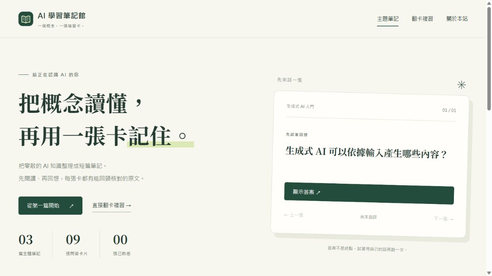

# AI 學習筆記館

繁體中文 AI 入門講義與翻卡複習網站。專案以 AGENTS.md、JSON 內容契約及共用版型，讓 AI 能依相同流程持續新增主題。

## 成果連結

- GitHub Repository：https://github.com/minyaowu/ai-study-notes
- 公開網站：https://minyaowu.github.io/ai-study-notes/
- 備用公開網站：https://ai-study-notes-01a18790.hinton-yuntech.chatgpt.site
- 開發規則：[AGENTS.md](AGENTS.md)
- 作業繳交說明：[SUBMISSION.md](SUBMISSION.md)
- 擴充實證：[evidence/extension-demo.md](evidence/extension-demo.md)
- 驗證結果與畫面：[evidence/verification.md](evidence/verification.md)

## 本機執行

需要 Python 3.10 以上，沒有必要的第三方套件。

~~~text
python scripts/build.py
python scripts/build.py --check
python -m unittest discover -s tests -v
python -m http.server 8000 --directory docs
~~~

以瀏覽器開啟 http://localhost:8000。也可直接打開 docs/index.html；內容與卡片資料已嵌入頁面，不依賴外部 API。

## 新增一篇主題

1. 閱讀 AGENTS.md。
2. 複製 templates/topic.example.json 到 content/<new-slug>.json。
3. 更改 slug、order、標題、講義、卡片及參考來源。卡片 evidence 須逐字存在於指定段落。
4. 執行建置、同步檢查與測試。
5. 檢查首頁新項目、主題頁與複習頁的主題篩選。

建置會自動更新所有主題導覽、首頁及複習卡，無須為每個主題修改版型或 JavaScript。詳細格式見 schemas/topic.schema.json。

## 功能與限制

- 三篇入門講義、九張附原文依據的問答卡。
- 主題搜尋、翻卡、主題／需再複習篩選、瀏覽器本機自評紀錄與 JSON 匯出。
- 不使用付費 API，不含帳號、模型推論或筆記上傳。
- 資料只存在使用中的瀏覽器；不同裝置、不同網址之間不會自動同步。
- 引文檢查不等於語意評分，卡片採翻卡自評。
- 內容由 AI 協助整理與開發，概念以官方及原始資料查核。提交前請由學生本人閱讀、理解及確認。

## 專案結構

content 為內容來源，templates 與 assets 為共用版型，scripts 為標準函式庫建置程式，docs 為自動產生的公開網站。tests、schemas、evidence 與 AGENTS.md 一起說明這套規則如何延續。

## GitHub Pages

完整原始碼與 docs 一起上傳至公開儲存庫。到 Settings → Pages，選擇 Deploy from a branch、main 分支及 /docs。等待 GitHub 顯示真實發布網址後，再更新 README、project.json 與 SUBMISSION.md。

若由其他靜態託管服務發布，使用 python scripts/build.py --deploy 產生 dist。所有站內路徑均為相對路徑，可部署於網域根目錄或 /repository-name/ 子路徑。

## 原創與來源

講義、例子、樣式與程式為本作業重新撰寫。外部來源列於各主題頁，供核對概念，沒有複製其他課程網站的程式或版型。此專案與期末「AI 筆記轉複習卡」共用學習輔助方向，成果目的與實作範圍不同。
