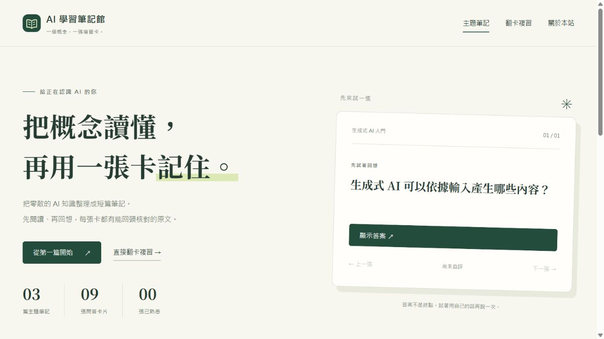
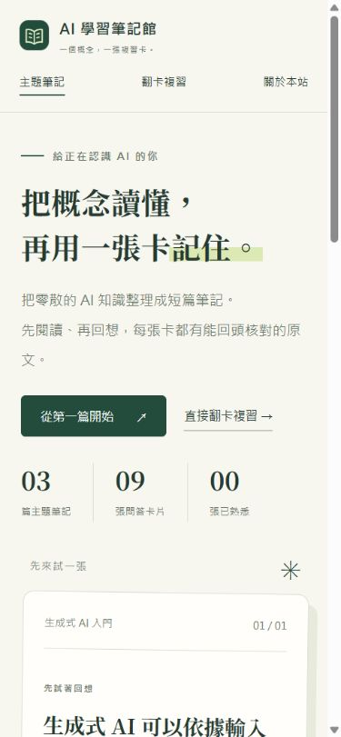

# 建置、操作與發布驗證

驗證日期：2026-11-08。

## 規則與機器檢查

- 三篇主題、九張卡片、六個 HTML 頁面。
- 建置成功；建置輸出與內容來源同步。
- 每張卡的必要欄位、來源編號與引用原句皆通過檢查。
- 所有產生的站內檔案連結與段落 anchor 均有效。
- 十二項測試通過，涵蓋無原文依據、錯誤來源、重複順序、缺欄位、路徑穿越、重複段落、JSON 錯誤、HTML 跳脫、失效段落連結、建置可重現、失敗不覆蓋產物及不安全來源協定。
- [GitHub 上的初次自動檢查](https://github.com/minyaowu/ai-study-notes/actions/runs/42466668465)成功。最新檢查可從儲存庫 Actions 查看。

## 瀏覽器操作

以實際瀏覽器操作確認：

| 情境 | 結果 |
|---|---|
| 搜尋「提示詞」 | 只顯示提示詞設計 |
| 搜尋不存在的主題 | 顯示明確的無結果訊息 |
| 卡片初始狀態 | 答案隱藏 |
| 揭示答案 | 正常顯示參考答案與來源入口 |
| 標記已熟悉 | 計數變為 01，並切換下一張卡 |
| 重新整理 | 自評紀錄仍保留 |
| 主題篩選 | 對應三張卡 |
| 需再複習篩選 | 只顯示已標記的卡 |
| 新增第三主題 | 下拉選項與三張卡自動出現 |
| 原文依據 | 可顯示第三主題的原句及 p1 來源連結 |
| 取消重設 | 原有紀錄保留 |
| 確定重設 | 關閉事件完成後計數歸零 |
| 鍵盤 Enter | 可操作答案揭示按鈕 |
| 390px 手機版 | 首頁與第三篇主題頁無水平溢位 |

對話框關閉是非同步事件，檢查時須等待關閉事件處理完成再讀取計數。原始觀察整理於 browser-checks.json。

## 發布驗證

- GitHub Repository：https://github.com/minyaowu/ai-study-notes
- GitHub Pages：https://minyaowu.github.io/ai-study-notes/
- GitHub Pages API 回報 built，來源為 main 分支的 /docs。
- 已實際開啟公開首頁，確認三篇講義、九張卡片及樣式正常。
- 備用網站託管回報 succeeded，公開網址為 https://ai-study-notes-01a18790.hinton-yuntech.chatgpt.site。

## 驗證界線

瀏覽器權限系統拒絕了實際下載操作，因此「下載卡組」與「匯出自評紀錄」的端到端下載驗證未完成，沒有改用其他方式繞過。卡組檔案的內容與站內連結已在本機建置檢查，不能將此標為瀏覽器下載已通過。

語意由 AI 助理逐張對照講義初步檢閱；學生本人仍須閱讀並確認。這些驗證不保證評分，也不等於所有瀏覽器或所有未來內容皆不會出錯。

## 成果畫面

以下為實際瀏覽器畫面，不是介面示意。

### GitHub Pages 公開首頁

### 桌面版

### 390px 手機版

